# Architecture

The diagram is generated from [Mermaid source](architecture.mmd) and optimized
with SVGO. Run `just diagram` from `crates/platform-dirs` to regenerate it, or
`just --justfile crates/platform-dirs/justfile diagram` from the workspace root.
See [Development tasks](index.md#development-tasks) for prerequisites.

## Responsibility and boundaries

`platform-dirs` resolves directories for persistent user state, shared data, and logs, optionally
appending a validated application name. It does not create directories or check
existence and permissions. The desktop passes `Some("chessvault")` and creates
the directory during initialization.

Paths remain OS-native `PathBuf` values so non-Unicode names are preserved.
Resolution happens on each call rather than being cached.

## Module structure

- [`src/lib.rs`](../src/lib.rs) exposes `user_state_dir(app_name)` and `user_share_dir(app_name)`,
  validates the name, and selects the
  development override, a native resolver, or an unsupported-platform error.
  It also exposes `user_log_dir(app_name, opinion)`, which delegates to
  `user_state_dir` and appends `log` unless `opinion` is `Some(false)`.
- [`src/linux.rs`](../src/linux.rs) owns Linux environment lookup, resolution
  policy, and its unit tests. It is private to the crate.

`system_share_dirs(app_name)` selects native system data resolution independently of the
user-directory development override, then validates and appends the application name to each path.
It validates names even for an empty search list.

User-directory APIs return `anyhow::Result<PathBuf>`; `system_share_dirs` returns
`anyhow::Result<Vec<PathBuf>>`. Platform-specific implementation details remain private.

## Compile-time selection

Conditional compilation selects the user-directory implementation:

| Configuration | Resolution |
| --- | --- |
| Debug assertions and `development` enabled | Current working directory plus `.local/state` or `.local/share`, on any platform |
| Otherwise, on Linux | Native Linux resolver |
| Otherwise, on other platforms | Unsupported-platform error |

The `development` feature is enabled by default. Disabling default features
allows native resolution in debug builds, but Cargo features are additive:
another dependency enabling `development` can re-enable the override.

System directories always use native resolution: Linux is supported and other platforms return
an error, regardless of the development feature. The Linux module therefore compiles on every
Linux build. User-directory policy helpers also compile during tests so their native policy can
be checked even when the public entry points use the development override.

## Resolution flow

The [Mermaid resolution diagram source](resolution.mmd) uses rounded shapes for entry and return
points, rectangles for actions, and diamonds for decisions. Blue decisions and
dashed edges show compile-time selection, not runtime configuration checks.
Home lookup checks for an absolute path value, not whether the directory exists
on disk. The base-directory flow covers both `user_state_dir` and `user_share_dir`:
each resolves its base first, then validates and appends the optional application name.
Base-resolution errors take precedence over invalid-name errors.
The separate log-wrapper flow calls `user_state_dir` and appends `log` for `None`
or `Some(true)`, or returns it unchanged for `Some(false)`. It propagates
state-directory errors unchanged.
Callers create directories as needed.

Both diagrams are regenerated and optimized by `just diagram`. The package's
documentation CI workflow also runs Mermaid CLI followed by one
SVGO pass before building the site. Generated diagram SVGs are ignored by Git;
commit only the Mermaid sources. Generate diagrams locally before building or
previewing the documentation site. GitHub Markdown previews will not display
these untracked diagrams; use the built site to view them.

## Linux resolution

The native wrappers read `XDG_STATE_HOME` for state or `XDG_DATA_HOME` for share
with `std::env::var_os` and pass it, along with `std::env::home_dir`, to internal
resolvers. Both use a common XDG resolution helper.

The resolver accepts an absolute XDG path immediately. Otherwise, it invokes
the home lookup and appends `.local/state` or `.local/share`, respectively, to an
absolute home path. Missing,
empty, and relative XDG values trigger the fallback; a missing or non-absolute
home produces an error.

The resolver emits a `tracing` info event when the XDG variable is unset and a
warning when it is set but not absolute (including an empty value). Events name
the variable and explain the fallback; warnings also include the rejected path.
These events announce the fallback attempt, which can still fail if no absolute
home is available. Valid absolute XDG values produce no event. Applications
configure the tracing subscriber and filter; the library does not install one.

Home lookup is lazy: a valid XDG path does not depend on home resolution.
Neither branch creates or validates the directory on disk.

### System data search paths

`system_share_dirs` reads `XDG_DATA_DIRS` with `std::env::var_os`. The injected resolver
uses `/usr/local/share:/usr/share` when the value is unset or empty, splits it with
`std::env::split_paths`, and discards non-absolute entries. A nonempty configured list with
no absolute entries produces an empty vector rather than falling back. Order, duplicates,
and non-Unicode paths are retained. No home lookup or filesystem access is needed, and the
user share directory is not included. The public wrapper appends an optional validated name.

## Testing strategy

Linux policy tests inject environment values and a home-lookup closure instead
of modifying the process environment. This keeps tests independent and allows
coverage of fallback errors, non-Unicode paths, and whether home lookup runs.

Log-directory tests cover all three opinion values with and without an application
name, including names containing spaces and Unicode. They also check that invalid
application names propagate the same errors as state-directory resolution.

System-directory tests cover unset and empty defaults, ordered lists with duplicates,
invalid entries, entirely invalid lists, non-Unicode paths, and application-name validation.

Share-directory tests cover optional application names, invalid names, XDG
fallbacks and errors, lazy home lookup, and non-Unicode paths.
Development-mode tests check both state and share public entry points against the
current working directory. Check both default and no-default-features builds
to exercise both public entry-point configurations on Linux. See the workspace
[testing guide](../../../docs/development/testing.md#platform-and-feature-variants).

## Adding a native platform

Add a private platform module and select it in `lib.rs` when the development
override is inactive, and for system directories regardless of that override.
Narrow the unsupported-platform branches accordingly and leave the user-directory
development override platform-independent.

Keep platform policy behind the existing public API, preserve OS-native paths,
and test platform inputs without mutating global process state. Verify the
native configuration on the target platform and update the support documentation.
